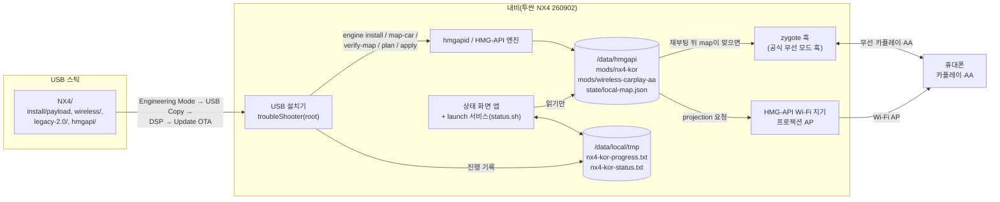
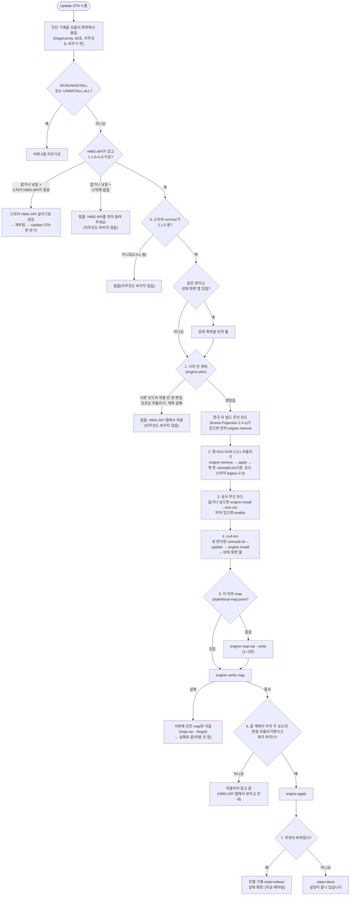
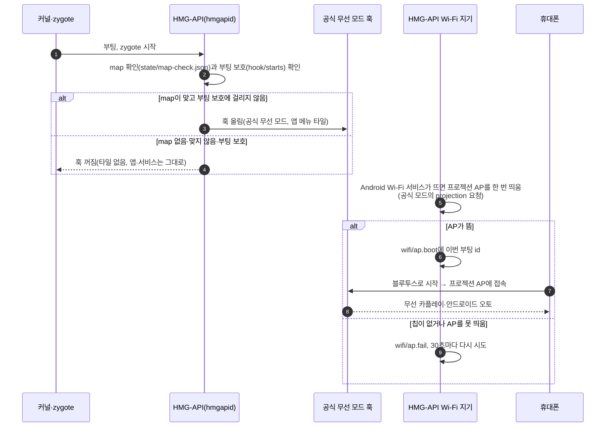
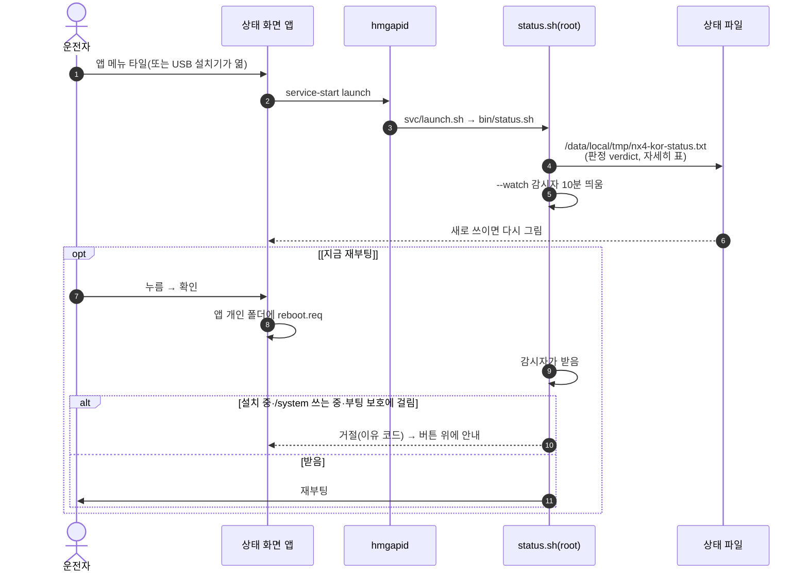
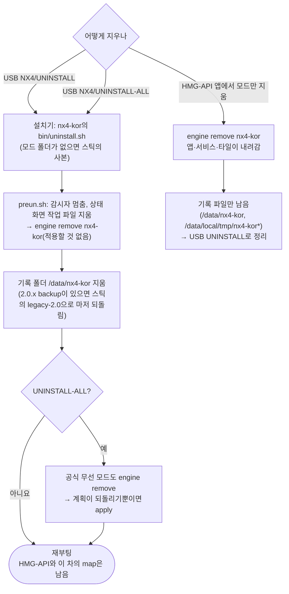

# NX4 KOR 2.1.0 처리 흐름

2.1.0에서 설치부터 무선 연결, 상태 화면, 지우기까지 무엇이 어떤 차례로 도는지 그림으로 모았습니다. 자세한 규칙과 근거는 [`design.md`](design.md)에 있고, 이 문서는 그 요약입니다. 둘이 다르면 `design.md`와 코드가 맞습니다.

> ⚠️ 2.1.0 흐름은 차에서 아직 확인하지 않았습니다. PC 테스트(`tests/mod-test.sh`)와 HMG-API 1.1.0-rc.8 엔진(PC)에서만 확인했습니다([#23](https://github.com/jay-park-lab/hmgapi-nx4-kor/issues/23), [#45](https://github.com/jay-park-lab/hmgapi-nx4-kor/issues/45)).

## 1. 누가 무엇을 하나

| 맡는 곳 | 하는 일 |
|---|---|
| USB 설치기(`usb/troubleShooter`, root) | HMG-API 확인·업데이트 넘기기, 옛 2.0.x 되돌리기, 공식 무선 모드 설치(`--any-car`), nx4-kor 설치, NX4 map 만들기·확인, 적용, 진행 기록, 지우기 |
| HMG-API(`hmgapid`, 엔진, zygote 훅) | 모드 설치·계획·적용, map, 부팅 때 훅 올리기, 프로젝션 AP 지기(Wi-Fi), 앱·서비스·타일 |
| 공식 무선 모드(`wireless-carplay-aa`, 고치지 않음) | 무선 카플레이·안드로이드 오토 훅, 계기판·HUD 길안내, 프로젝션 AP 요청(`"wifi": {"projection": true}`) |
| nx4-kor 모드(이 저장소) | 상태 화면 앱과 앱 메뉴 타일, 앱이 부르는 `launch` 서비스(`bin/status.sh`). 훅·시스템 파일·Wi-Fi 설정은 건드리지 않음 |

## 2. 설치·업데이트 (USB Update OTA)

같은 판도 같은 차례로 돌고, 이미 된 단계는 건너뜁니다. 설치기는 재부팅하지 않고 상태 화면의 [지금 재부팅]을 안내합니다. 단계별 규칙은 `design.md` "설치·업데이트 순서"에 있습니다.

- 진행 기록 `/data/local/tmp/nx4-kor-progress.txt`(`state`: `run`·`done`·`reboot`·`fail`)는 1단계 뒤 무엇을 바꾸기 시작할 때부터 씁니다. 상태 화면이 이 파일로 막대와 결과를 그립니다.
- map 만들기·확인과 적용은 USB 설치기만 합니다(2026-11-23 결정, [#45](https://github.com/jay-park-lab/hmgapi-nx4-kor/issues/45)). 차에 남는 nx4-kor는 부팅 때 아무것도 설정하지 않습니다.
- 설치기 기록은 스틱의 `NX4/install.log`에 이어 씁니다.

## 3. 재부팅 뒤 무선 연결

- Wi-Fi 부품이 없는 차(2026-11-23 NX4HEV 260902)는 AP가 뜨지 않습니다. 유선 카플레이·안드로이드 오토와 계기판 길안내는 그대로이고, 무선은 USB Wi-Fi 동글([#48](https://github.com/jay-park-lab/hmgapi-nx4-kor/issues/48))을 기다립니다.
- HMG-API "집 Wi-Fi"를 켜면 주차한 동안만 HMG-API가 AP를 끄고 집 Wi-Fi에 붙습니다.

## 4. 상태 화면

판정은 `bin/status.sh`의 `st_verdict` 한 곳에서 정하고, 앞에서부터 처음 맞는 것이 판정입니다. 읽기만 하고 아무것도 바꾸지 않습니다(전체 표는 `design.md` "상태 화면").

```mermaid
flowchart LR
  A["1 bootguard<br/>부팅 보호"] --> B["2 installing<br/>설치 중"]
  B --> C["3 nocar<br/>다른 차"]
  C --> D["4 nohmgapi·oldhmgapi<br/>HMG-API 없음·낮음"]
  D --> E["5 reboot·failed<br/>설치기 결과"]
  E --> F["6 nowireless·wirelessoff·oldwireless<br/>공식 모드"]
  F --> G["7 hooksoff<br/>HMG-API 훅 꺼짐"]
  G --> H["8 wmhooksoff<br/>공식 모드 훅 꺼짐"]
  H --> I["9 bridgeoff · 10 nofeat ·<br/>11 noproj"]
  I --> J["12 connected<br/>무선 연결됨"]
  J --> K["13 otherwifi · 14 aphotspot ·<br/>15 ready · 16 wificlient"]
  K --> L["17 apoff · 18 apwait ·<br/>19 nowifipart · 20 apfail"]
```

## 5. 지우기

- 상태 화면에는 지우기 버튼을 두지 않습니다([#44](https://github.com/jay-park-lab/hmgapi-nx4-kor/issues/44)). 2.1.0의 nx4-kor는 시스템 파일·Wi-Fi 설정을 바꾸지 않아 HMG-API 앱에서 지워도 기록 파일만 남기 때문입니다.
- USB 설치기 자신의 기록(`nx4-kor-usb.log`, 차에서는 `nx4-kor-ota-finish.sh`)은 지우기 뒤에도 남습니다.
- 둘 다 지울 때는 NX4 KOR를 먼저, HMG-API를 나중에 지웁니다(README "삭제").
