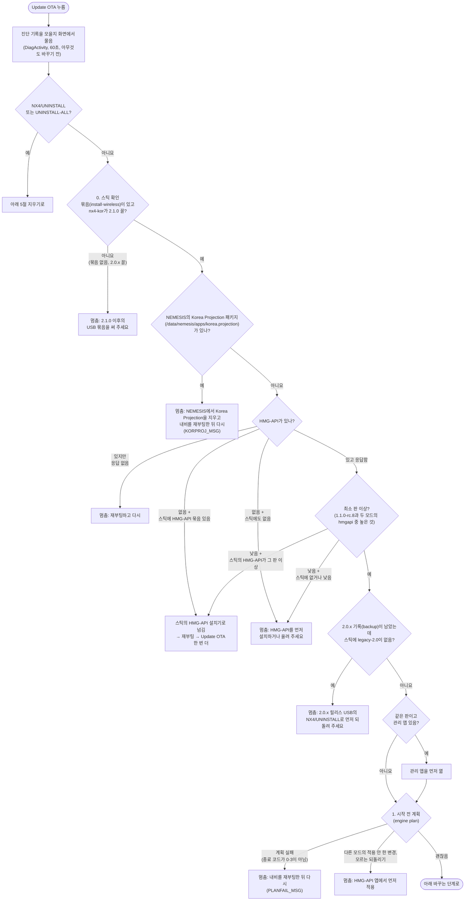
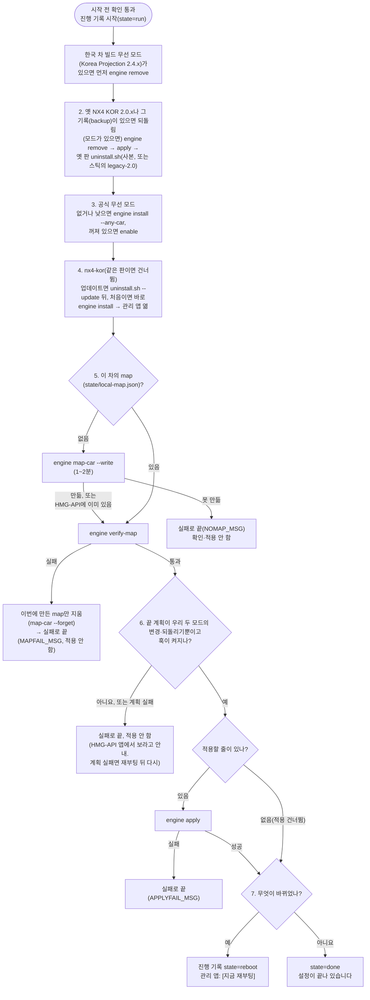
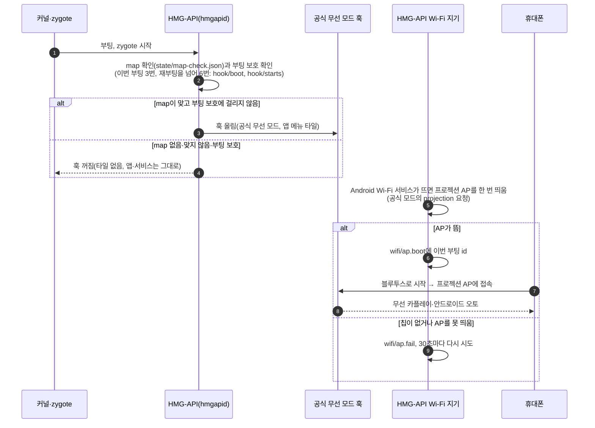
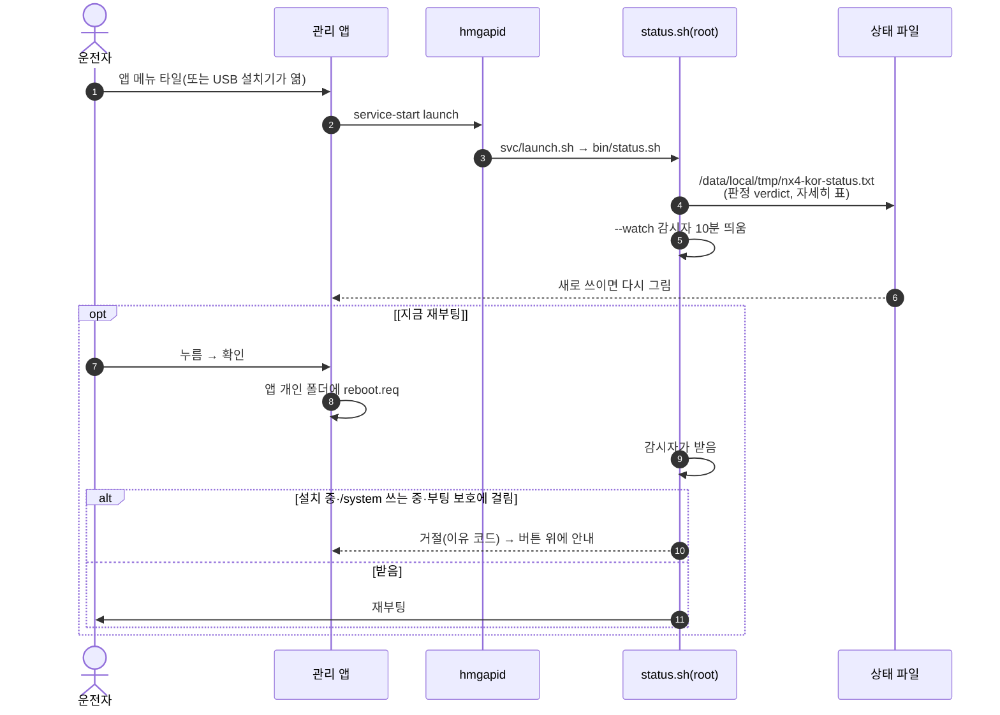
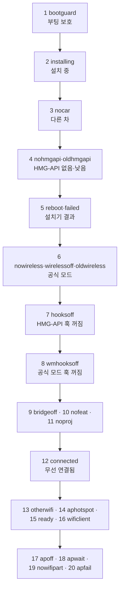
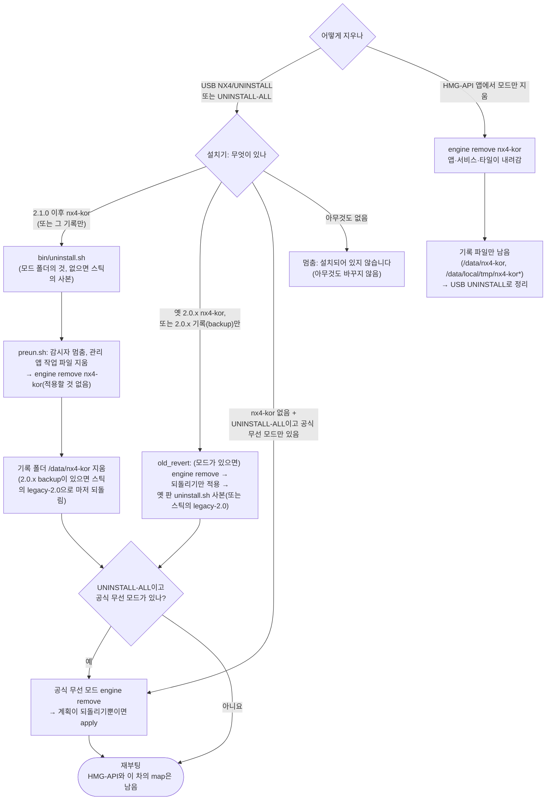

# NX4 KOR 2.1.0 처리 흐름

2.1.0에서 설치부터 무선 연결, 관리 앱, 지우기까지 무엇이 어떤 차례로 도는지 그림으로 모았습니다. 자세한 규칙과 근거는 [`design.md`](design.md)에 있고, 이 문서는 그 요약입니다. 둘이 다르면 `design.md`와 코드가 맞습니다.

> ⚠️ 2.1.0 흐름은 차에서 아직 확인하지 않았습니다. PC 테스트(`tests/mod-test.sh`)와 HMG-API 1.1.0-rc.8 엔진(PC)에서만 확인했습니다([#23](https://github.com/jay-park-lab/hmgapi-nx4-kor/issues/23), [#45](https://github.com/jay-park-lab/hmgapi-nx4-kor/issues/45)).

## 1. 누가 무엇을 하나

| 맡는 곳 | 하는 일 |
|---|---|
| USB 설치기(`usb/troubleShooter`, root) | HMG-API 확인·업데이트 넘기기, 옛 2.0.x 되돌리기, 공식 무선 모드 설치(`--any-car`), nx4-kor 설치, NX4 map 만들기·확인, 적용, 진행 기록, 지우기 |
| HMG-API(`hmgapid`, 엔진, zygote 훅) | 모드 설치·계획·적용, map, 부팅 때 훅 올리기, 프로젝션 AP 지기(Wi-Fi), 앱·서비스·타일 |
| 공식 무선 모드(`wireless-carplay-aa`, 고치지 않음) | 무선 카플레이·안드로이드 오토 훅, 계기판·HUD 길안내, 프로젝션 AP 요청(`"wifi": {"projection": true}`) |
| nx4-kor 모드(이 저장소) | 관리 앱과 앱 메뉴 타일, 앱이 부르는 `launch` 서비스(`bin/status.sh`). 훅·시스템 파일·Wi-Fi 설정은 건드리지 않음 |

## 2. 설치·업데이트 (USB Update OTA)

같은 판도 같은 차례로 돌고, 이미 된 단계는 건너뜁니다. 설치기는 재부팅하지 않고 관리 앱의 [지금 재부팅]을 안내합니다. 단계별 규칙은 `design.md` "HMG-API 확인"과 "설치·업데이트 순서"에 있습니다. 그림은 시작 전 확인과 바꾸는 단계로 나눴습니다.

### 시작 전 확인

이 그림의 멈춤은 모두 아무것도 바꾸지 않고, 진행 기록도 쓰지 않습니다. 차례는 설치기(`usb/troubleShooter`)가 도는 차례입니다(스틱 확인, Korea Projection 패키지 확인, HMG-API 확인 순). Korea Projection 패키지는 HMG-API 설치기로 넘기기(HMG-API를 설치·업데이트하고 재부팅) 전에 봅니다.

- Korea Projection 패키지 확인은 그 패키지 폴더만 봅니다. 다른 NEMESIS 패키지는 막지 않고, 지우기(5절)도 막지 않습니다([#13](https://github.com/jay-park-lab/hmgapi-nx4-kor/issues/13)). 이 멈춤은 같은 판의 관리 앱 열기보다 앞이라 관리 앱을 열지 않습니다.
- HMG-API의 판을 읽지 못하거나 비교할 수 없으면 기록만 하고 지나갑니다. 엔진이 설치할 때 다시 봅니다.
- 설치된 nx4-kor가 2.0.x 자체면 아래 2단계에서 그 판의 것으로 되돌립니다. 그래서 `legacy-2.0` 멈춤(`OLDLEFT_MSG`)에 걸리지 않습니다.
- "같은 판"은 `NX4/REINSTALL`이 없고 2.0.x 기록도 없을 때입니다.

### 바꾸는 단계

- 진행 기록 `/data/local/tmp/nx4-kor-progress.txt`(`state`: `run`·`done`·`reboot`·`fail`)는 1단계 뒤 무엇을 바꾸기 시작할 때부터 씁니다. 관리 앱이 이 파일로 막대와 결과를 그립니다.
- 그림에서 뺀 실패 갈래입니다. 모두 진행 기록을 `state=fail`로 끝내고 뒤 단계는 하지 않습니다.
  - 한국 차 빌드를 지우지 못함, 공식 무선 모드 설치 실패(`WFAIL_MSG`)
  - 옛 2.0.x 되돌리기 실패(`OLDFAIL_MSG`). 뺀 뒤 계획에 다른 변경이 있으면 적용하지 않고 끝 계획과 같은 안내로 끝납니다
  - nx4-kor 설치 거절(`INSTFAIL_MSG`). 예전 판에서 돌던 서비스를 다시 띄웁니다
- 2단계에서 nx4-kor 없이 2.1.0 이후의 기록(`/data/nx4-kor`)만 남은 차는 스틱의 사본(`payload/bin/uninstall.sh`)으로 정리만 합니다. 실패해도 계속합니다.
- map 만들기·확인과 적용은 USB 설치기만 합니다(2026-11-23 결정, [#45](https://github.com/jay-park-lab/hmgapi-nx4-kor/issues/45)). 차에 남는 nx4-kor는 부팅 때 아무것도 설정하지 않습니다.
- 설치기 기록은 스틱의 `NX4/install.log`에 이어 씁니다.

## 3. 재부팅 뒤 무선 연결

- Wi-Fi 부품이 없는 차(2026-11-23 NX4HEV 260902)는 AP가 뜨지 않습니다. 유선 카플레이·안드로이드 오토와 계기판 길안내는 그대로이고, 무선은 USB Wi-Fi 동글([#48](https://github.com/jay-park-lab/hmgapi-nx4-kor/issues/48))을 기다립니다.
- HMG-API "집 Wi-Fi"를 켜면 주차한 동안만 HMG-API가 AP를 끄고 집 Wi-Fi에 붙습니다.

## 4. 관리 앱

판정은 `bin/status.sh`의 `st_verdict` 한 곳에서 정하고, 앞에서부터 처음 맞는 것이 판정입니다. 읽기만 하고 아무것도 바꾸지 않습니다(전체 표는 `design.md` "관리 앱").

## 5. 지우기

- 자세한 갈래는 `design.md` "설치·업데이트·지우기"의 "지우기"에 있습니다.
- 그림에서 뺀 멈춤이 둘 있습니다. HMG-API가 있는데 응답하지 않을 때("재부팅하고 다시"), 모드 폴더 없이 2.0.x 기록만 남았는데 스틱에 `legacy-2.0`이 없을 때(`OLDLEFT_MSG`)입니다. 이 둘과 "설치되어 있지 않습니다", 스틱의 사본을 `/data`로 복사하지 못할 때("USB에서 복사하지 못했습니다")는 아무것도 바꾸지 않고 재부팅하지 않습니다. 그 밖에는 지우기가 실패해도 끝에 재부팅합니다.
- HMG-API를 먼저 지운 차는 `old_revert` 없이(계획·적용 없이) 그 `uninstall.sh`만 돌립니다. 2.0.x 기록만 남았으면 스틱의 `legacy-2.0` 사본을 돌립니다.
- 공식 무선 모드를 뺀 뒤 계획에 다른 변경이 있으면 적용하지 않고 "HMG-API 앱에서 변경 사항을 적용해 주세요(무선 모드 삭제)"로 알립니다.
- 2.1.0의 `uninstall.sh`가 남긴 2.0.x 기록을 이 스틱으로 되돌리지 못하면(`legacy-2.0` 없음) 그 폴더를 남기고 화면에 알립니다.
- 관리 앱에는 지우기 버튼을 두지 않습니다([#44](https://github.com/jay-park-lab/hmgapi-nx4-kor/issues/44)). 2.1.0의 nx4-kor는 시스템 파일·Wi-Fi 설정을 바꾸지 않아 HMG-API 앱에서 지워도 기록 파일만 남기 때문입니다.
- USB 설치기 자신의 기록(`nx4-kor-usb.log`, 차에서는 `nx4-kor-ota-finish.sh`)은 지우기 뒤에도 남습니다.
- 둘 다 지울 때는 NX4 KOR를 먼저, HMG-API를 나중에 지웁니다(README "삭제").
